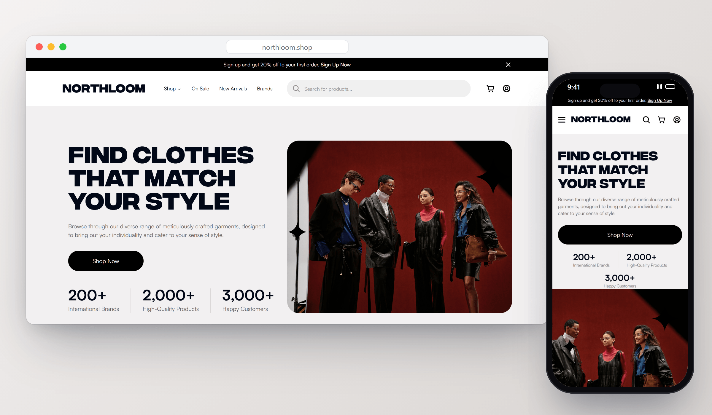
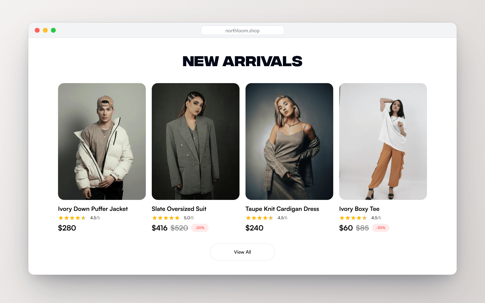
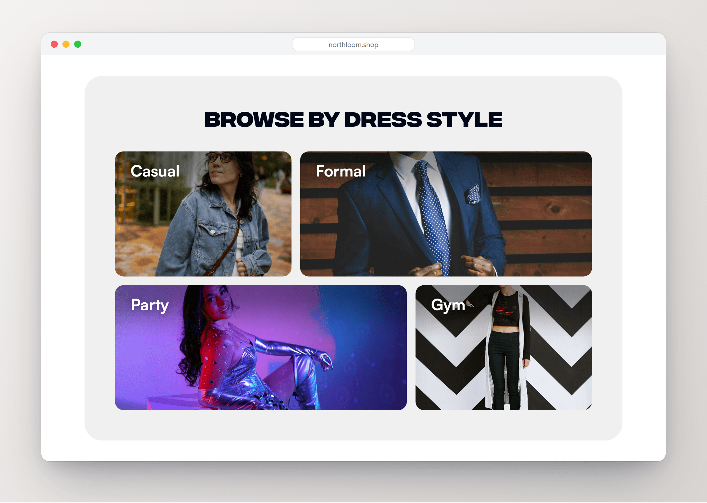
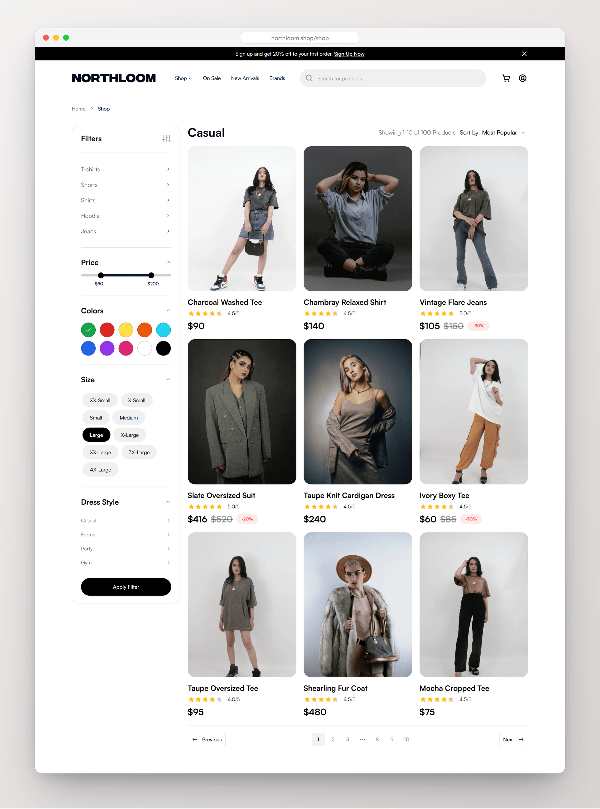
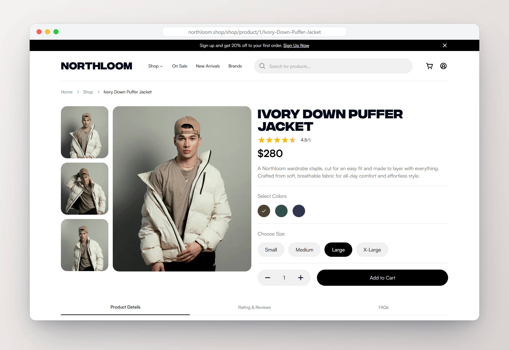
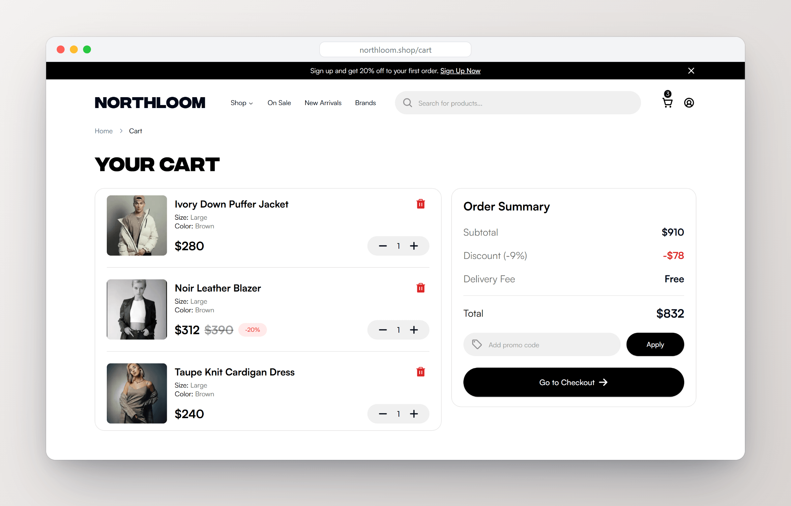
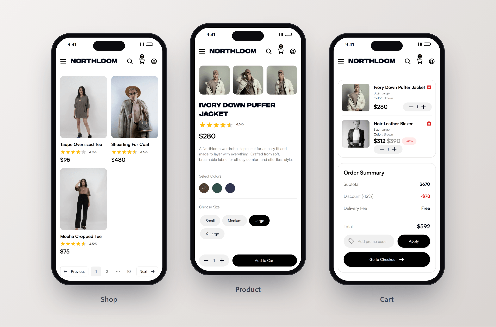
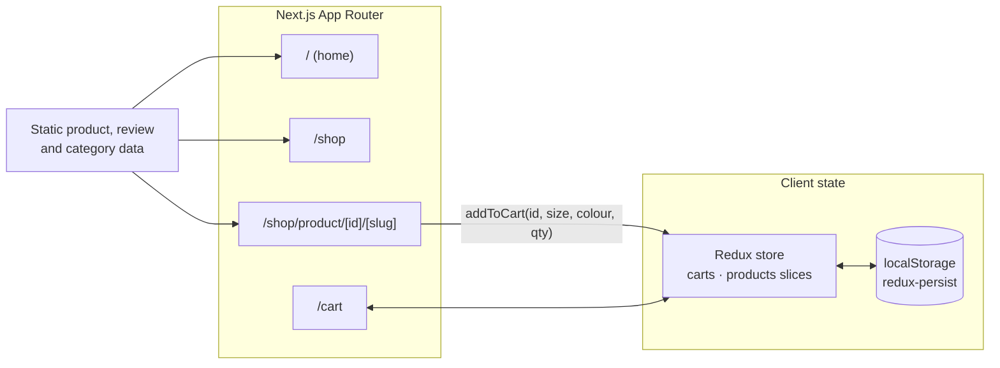

<div align="center">

# Northloom

**A responsive fashion storefront with an editorial home page, a filterable shop, product pages with studio photography and a cart that survives reloads.**


[Features](#features) · [Design](#design) · [Screenshots](#screenshots) · [Tech stack](#tech-stack) · [Getting started](#getting-started)

</div>

<br>

<p align="center"></p>

## Overview

Northloom is the customer-facing side of a clothing store, built mobile-first from a design system of bold display type, rounded product cards and full-bleed photography. It covers the browsing journey end to end: discovering products on the home page, narrowing them down in the shop, choosing a colour and size on the product page, and reviewing the order in the cart.

It is a front-end project. Products, reviews and categories are typed static data, and the cart lives in Redux persisted to `localStorage`, so it runs anywhere with no backend, keys or database. The data layer is a single module, which makes it straightforward to swap in a real catalog API.

## Try the demo

```bash
npm install
npm run dev
```

Open http://localhost:3000. There is no login. Pick any product, choose a colour and size, add it to the cart, then open the cart icon. The cart survives reloads and new tabs.

## Features

### A home page that sells the style

A headline hero with animated counters, "New Arrivals" and "Top Selling" rows, a "Browse by dress style" bento grid, a customer reviews carousel and a newsletter block.

<p align="center"></p>

<p align="center"></p>

### A shop with filters on every axis

Category, price range, colour, size and dress-style filters in a desktop sidebar or a mobile drawer, plus sort, pagination and breadcrumbs.

<p align="center"></p>

### Product page and a persistent cart

A photo gallery with thumbnails, rating, discount badge, colour and size selection and a quantity stepper, with tabs for details, reviews and FAQs. The cart keeps one line per product, size and colour, shows the discount in the order summary and is restored on every visit.

| | |
| --- | --- |
|  |  |

<details>
<summary><b>Full feature list</b></summary>

**Home**
- Hero with headline, call to action and animated counters.
- Brand strip, "New Arrivals" and "Top Selling" product rows, "Browse by dress style" bento grid and a customer reviews carousel.
- Announcement bar and newsletter sign-up block.

**Shop**
- Product grid with category, price range, colour, size and dress-style filters.
- Desktop sidebar filters and a mobile filter drawer.
- Sort control, pagination and breadcrumbs.

**Product page**
- Photo gallery with thumbnails, rating, price with discount badge.
- Colour and size selection and a quantity stepper.
- Tabs for product details, ratings and reviews, and FAQs, plus a "You might also like" row.

**Cart**
- Line items keyed by product, size and colour, with quantity controls and removal.
- Order summary with subtotal, discount and total, and a cart badge in the navbar.
- State persisted with `redux-persist`, so the cart survives reloads.

**Across the app**
- Mobile navigation drawer, responsive layouts from 390px up and Framer Motion entrance animations.
- Accessible primitives from Radix UI (accordion, dialog, select, slider, navigation menu).

</details>

## Design

- **Bold editorial type.** A heavy, wide display face in capitals for headlines and section titles, paired with a light geometric sans for body text and prices.
- **A monochrome system.** Black, white and a warm off-white surface carry the whole interface, so the photography supplies the color. Red is kept for discount badges and price reductions.
- **Rounded, soft surfaces.** Large radii on product images, pill-shaped buttons and inputs, and hairline-bordered cards for the cart and filters.
- **Mobile first.** The navbar collapses to a drawer, filters move into a bottom sheet (vaul), product rows become swipeable carousels (Embla) and the hero stacks above its image.
- **Motion.** Framer Motion entrance animations on sections and counters, and a route progress bar from holy-loader.
- **Accessible primitives.** shadcn/ui components on Radix (accordion, dialog, select, slider, navigation menu) bring focus management and keyboard support.

<p align="center"></p>

## Screenshots

All screenshots come from the running app: desktop at 1440×900 and mobile at 390×844, both at retina resolution. The store ships a light theme only; shadcn dark tokens exist in the CSS but no component uses them.

## Tech stack

| Layer | Technology | Why |
| --- | --- | --- |
| Framework | Next.js 14.2 (App Router), React 18.3 | File-based routes for home, shop, product and cart |
| Language | TypeScript 5 | Typed product, review and discount models |
| Styling | Tailwind CSS 3.4, tailwindcss-animate, local display and body fonts | Utility styling with a small custom type scale |
| UI primitives | Radix UI through shadcn/ui, vaul, Embla carousel, lucide-react and react-icons | Accessible building blocks without a heavy component library |
| State | Redux Toolkit 2, react-redux 9, redux-persist 6 | Predictable cart updates that persist across reloads |
| Motion | Framer Motion 11 | Entrance and counter animations |
| Other | holy-loader, react-simple-star-rating, usehooks-ts | Route progress, star ratings and media-query hooks |

## Architecture



**Key decisions**

- **Static data behind one module.** Products and reviews are typed arrays (`src/types`), so every page renders without a backend. Moving them to an API or CMS only touches the data module and the pages that import it.
- **Redux Toolkit for the cart.** The cart slice handles add, remove and quantity changes, keyed by product plus selected size and colour so the same item in two sizes is two lines. Totals and discounts are derived in the slice. Only the cart is persisted (`whitelist: ["carts"]`); the products slice holds transient selection state.
- **SSR-safe persistence.** `src/components/storage` provides a no-op storage on the server and `localStorage` in the browser, so `redux-persist` does not break server rendering.
- **shadcn/ui primitives.** Radix-based components live in `src/components/ui` and are styled with Tailwind, keeping accessibility (focus management, keyboard support) without a heavy component library.


## Engineering highlights

- **Only the cart is persisted.** The store whitelists the `carts` slice, so transient product-selection state never ends up in `localStorage`.
- **SSR-safe storage.** `redux-persist` gets a no-op storage on the server and `localStorage` in the browser, so server rendering never touches `window`.
- **Cart lines keyed by attributes.** Adding the same product in a second size or colour creates a new line; adding the same combination increments the quantity.

```ts
// src/lib/store.ts
const persistConfig = {
  key: "root",
  storage,
  version: 1,
  whitelist: ["carts"],
};

const rootReducer = combineReducers({
  products: productsReducer,
  carts: cartsReducer,
});

export const makeStore = () => {
  const store = configureStore({
    reducer: persistReducer(persistConfig, rootReducer),
    devTools: process.env.NODE_ENV !== "production",
    middleware: (getDefaultMiddleware) => getDefaultMiddleware({ serializableCheck: false }),
  });
  return { store, persistor: persistStore(store) };
};
```

```ts
// src/components/storage/index.tsx
const storage =
  typeof window !== "undefined"
    ? createWebStorage("local")
    : createNoopStorage(); // getItem → null, setItem/removeItem → resolved promises
```

## Getting started

**Prerequisites**

- Node.js 18.17 or newer and npm

**Setup**

```bash
git clone <repository-url> northloom
cd northloom
npm install
npm run dev
```

The app runs on http://localhost:3000. No environment variables are required.


<details>
<summary><b>Scripts</b></summary>

| Script | What it does |
| --- | --- |
| `npm run dev` | Development server. |
| `npm run build` | Production build (see the note under Roadmap). |
| `npm start` | Serve the production build. |
| `npm run lint` | Next.js ESLint rules. |

</details>

<details>
<summary><b>Project structure</b></summary>

```
src/
  app/
    page.tsx             home page and the static product and review data
    shop/                shop listing and product/[...slug] detail page
    cart/                cart page
    layout.tsx           fonts, metadata, navbar, footer, providers
    providers.tsx        Redux store and PersistGate
  components/
    homepage/            hero, brands, dress style grid, reviews
    shop-page/           breadcrumb and filter sections (desktop and mobile)
    product-page/        gallery, colour/size selection, add to cart, tabs
    cart-page/           cart line item and breadcrumb
    common/              product card, product row, review card
    layout/              announcement banner, navbar, footer
    ui/                  shadcn/ui primitives
    storage/             SSR-safe storage for redux-persist
  lib/
    store.ts             store setup and persistence config
    features/            carts and products slices
    hooks/               typed Redux hooks
  types/                 Product, Review, Discount types
  styles/                global CSS and local fonts
public/images/           product, hero and dress-style photography
```

</details>

## Testing & quality

```bash
npm run lint
npx tsc --noEmit
```

There is no automated test suite yet. Type checking currently reports one error, caused by the build issue described below.

## Deployment

Any Node host that runs Next.js works, and Vercel needs no configuration. There are no environment variables. Fix the build issue below first.

## Roadmap

- **Fix the production build.** `src/app/page.tsx` exports the product arrays, and Next.js only allows Page-related exports from a page file, so `next build` fails type checking. Move the data to `src/data/products.ts` and update the imports in the shop and product pages.
- Upgrade Next.js to a patched release (14.2.7 has a published security advisory).
- Make search, sort, pagination and the filters operate on the data instead of being visual only.
- Gate only cart-dependent components behind `PersistGate`, so the rest of the page renders on the server instead of showing a spinner until hydration.
- Add a checkout flow, plus unit tests for the cart slice and Playwright tests for the browse-to-cart journey.
- Fix the discount check in `calcAdjustedTotalPrice` (`src/lib/features/carts/cartsSlice.ts`): `totalPrice + data.discount.percentage > 0` is parsed as `(totalPrice + percentage) > 0`, so fixed-amount discounts are ignored once the cart has a total.