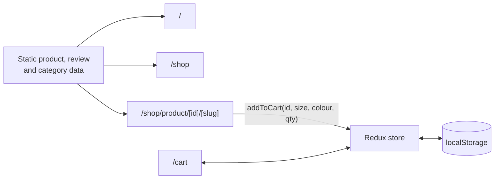

# Northloom storefront


The customer-facing side of a clothing store, built mobile-first around bold display type, rounded product cards and full-bleed photography. It covers the browsing journey from the home page to the cart.

It is a front-end project: products, reviews and categories are typed static data, and the cart lives in the browser. No backend, keys or database. The data sits in a single module, so swapping in a real catalog API only touches that module and the pages that import it.

| Layer | Tech |
| --- | --- |
| Framework | Next.js 14.2 (App Router), React 18.3, TypeScript 5 |
| Styling | Tailwind CSS 3.4, tailwindcss-animate, local fonts |
| Primitives | shadcn/ui on Radix, vaul, Embla, lucide-react, react-icons |
| State | Redux Toolkit 2, react-redux 9, redux-persist 6 |
| Motion | Framer Motion 11, holy-loader |

## Pages

| Route | What it shows |
| --- | --- |
| `/` | Hero with headline, call to action and animated counters; brand strip; "New Arrivals" and "Top Selling" rows; "Browse by dress style" bento grid; customer reviews carousel; newsletter block |
| `/shop` | Product grid with category, price range, colour, size and dress-style filters (sidebar on desktop, drawer on mobile), sort, pagination and breadcrumbs |
| `/shop/product/[id]/[slug]` | Photo gallery with thumbnails, rating, price with discount badge, colour and size selection, quantity stepper, tabs for details, reviews and FAQs, and a "You might also like" row |
| `/cart` | Line items with quantity controls and removal, order summary with subtotal, discount and total |

An announcement bar, the navbar (with a cart badge) and the footer appear on every page. On phones the navbar collapses into a drawer and product rows become swipeable carousels.

A quick tour: pick any product on the home page, choose a colour and size, add it to the cart, then open the cart icon. Reload the page and the cart is still there.

## Cart & state



The store has two Redux Toolkit slices:

- **`carts`** holds the cart. Lines are keyed by product, size and colour, so the same item in two sizes is two lines and adding the same combination again bumps the quantity. Totals and discounts are derived in the slice.
- **`products`** holds transient selection state on the product page.

Only `carts` is persisted:

```ts
const persistConfig = {
  key: "root",
  storage,
  version: 1,
  whitelist: ["carts"],
};
```

`storage` is SSR-safe. It is `localStorage` in the browser and a no-op on the server, so `redux-persist` never touches `window` during server rendering:

```ts
const storage =
  typeof window !== "undefined"
    ? createWebStorage("local")
    : createNoopStorage();
```

The cart survives reloads and new tabs. `providers.tsx` wraps the app in the Redux store and `PersistGate`.

## Design system

- **Type:** a heavy, wide display face in capitals for headlines; a light geometric sans for body and prices.
- **Color:** black, white and a warm off-white. Red only for discounts.
- **Shape:** large radii on images, pill buttons and inputs, hairline-bordered cards.
- **Primitives:** shadcn/ui on Radix (accordion, dialog, select, slider, navigation menu), styled with Tailwind.
- **Mobile:** navbar drawer, filters in a bottom sheet (vaul), swipeable product rows (Embla).
- **Motion:** Framer Motion entrances and counters, route progress from holy-loader.

Light theme only.

## Getting started

Node.js 18.17 or newer.

```bash
git clone <repository-url> northloom
cd northloom
npm install
npm run dev
```

Open http://localhost:3000. No environment variables are needed. Pick a product, choose a colour and size, add it to the cart and open the cart icon.

| Script | |
| --- | --- |
| `npm run dev` | Development server |
| `npm run build` | Production build |
| `npm start` | Serve the build |
| `npm run lint` | ESLint |

> `npm run build` currently fails type checking: `src/app/page.tsx` exports the product arrays, and Next.js only allows page-related exports from a page file. Moving the data to its own module fixes it.

Known gaps:

- Search, sort, pagination and the filters are visual only for now.
- No automated tests yet; `npm run lint` and `npx tsc --noEmit` are the checks.
- No checkout flow; the journey ends at the cart.
- Next.js 14.2.7 has a published security advisory, so an upgrade is due.

Any Node host that runs Next.js works, and Vercel needs no configuration once the build is fixed.

## Project structure

```
src/
  app/
    page.tsx      home page (and, for now, the static product data)
    shop/         listing and product detail
    cart/         cart page
    layout.tsx    fonts, metadata, navbar, footer
    providers.tsx Redux store and PersistGate
  components/     homepage, shop-page, product-page, cart-page, common, layout
  components/ui/  shadcn/ui primitives
  lib/            store setup, carts and products slices, typed hooks
  types/          Product, Review, Discount
  styles/         global CSS and local fonts
public/images/    product, hero and dress-style photography
```